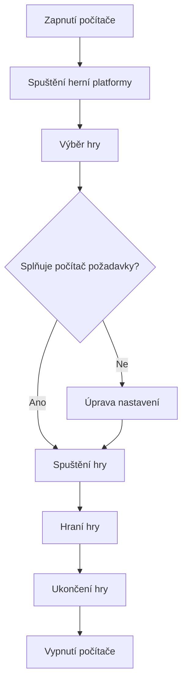

🎮 Gaming – svět počítačových her

Vítej v mém projektu o počítačových hrách! Počítačové hry jsou oblíbenou formou zábavy po celém světě. Nabízejí dobrodružství, soutěžení, kreativitu a možnost hrát s kamarády.

1. Co je gaming?

Gaming znamená hraní počítačových a konzolových her. Existuje mnoho různých herních žánrů, které se liší stylem hraní a cílem.

 Nejoblíbenější herní žánry

- FPS– střílečky z pohledu první osoby.
- RPG – hry na hrdiny s příběhem a vývojem postavy.
- Sportovní hry – například fotbal nebo basketbal.
- Závodní hry – závody aut a motorek.
- Survival – hry o přežití v nebezpečném prostředí.

Každý hráč si může najít žánr, který ho baví.*

 2. Známé počítačové hry

 Minecraft

Minecraft je populární hra, ve které hráči staví budovy, prozkoumávají svět a sbírají suroviny.

### Counter-Strike 2

Counter-Strike 2 je týmová střílečka, ve které proti sobě soutěží dva týmy.

### Fortnite

Fortnite je akční hra, která kombinuje přežití, stavění a souboje proti ostatním hráčům.

### GTA V

Grand Theft Auto V je akční hra s otevřeným světem, ve kterém mohou hráči plnit mise a prozkoumávat město.

## 3. Herní vybavení


*Herní počítač s monitorem, klávesnicí a myší.*

| Vybavení      | Využití                    |
| ------------- | -------------------------- |
| Herní počítač | Spouštění her              |
| Monitor       | Zobrazení obrazu           |
| Klávesnice    | Ovládání hry               |
| Myš           | Přesné ovládání            |
| Sluchátka     | Poslech zvuků a komunikace |
| Herní židle   | Pohodlné sezení            |

## 4. Výhody a nevýhody gamingu

**Výhody:**

- Rozvoj logického myšlení.
- Zlepšení reakcí a koordinace.
- Možnost hrát s přáteli.
- Odpočinek a zábava.

**Nevýhody:**

- Příliš dlouhé sezení u počítače.
- Nedostatek pohybu.
- Možnost závislosti na hraní.
- Únava očí.

*Nejdůležitější je najít rovnováhu mezi hraním a skutečným životem.*

## 5. Ukázka programu v Pythonu

Tento program zjistí, kolik hodin hráč strávil hraním her za týden.

pondeli = 2 utery = 3 streda = 1 ctvrtek = 2 patek = 4  celkem = pondeli + utery + streda + ctvrtek + patek  print("Herní čas za týden:", celkem, "hodin")  if celkem > 10:     print("Zkus si udělat také čas na jiné aktivity.") else:     print("Tvůj herní čas je pod 10 hodin.")

## 6. Užitečné odkazy

- [Steam – platforma pro počítačové hry](https://store.steampowered.com/)
- [Epic Games – herní obchod](https://store.epicgames.com/)
- [IGN – herní novinky a recenze](https://www.ign.com/)

## 7. Můj herní To-Do list

- [x] Vybrat oblíbené herní žánry.
- [x] Najít zajímavé počítačové hry.
- [ ] Vyzkoušet novou počítačovou hru.
- [ ] Zahrát si s kamarády.
- [ ] Dokončit nějakou příběhovou hru.

 8. Matematika v gamingu

Pomocí matematiky můžeme vypočítat například průměrný herní čas.

```math
\text{Průměr} = \frac{\text{Celkový čas hraní}}{\text{Počet dní}}
```

Pokud hráč hraje 14 hodin během 7 dní, jeho průměr je 2 hodiny denně.


## 9. Vývojový diagram – spuštění hry



 Závěr

Gaming je zajímavý svět plný zábavy, soutěžení a dobrodružství. Počítačové hry mohou rozvíjet různé schopnosti a spojovat lidi. Je ale důležité hrát s rozumem a nezapomínat na ostatní aktivity.

Gaming není jen hraní, je to celý svět!🎮
